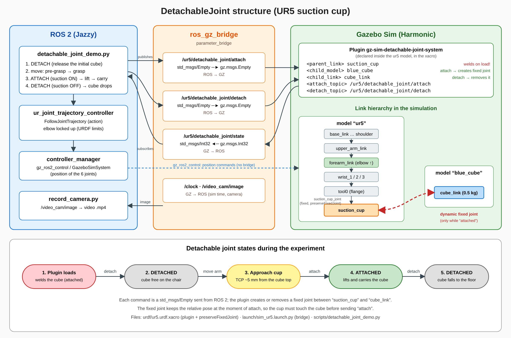

# ros2_experiments

Repository for experiments and configurations for manipulator robots using **ROS 2 Jazzy Jalisco**.

## Repository Content

- **ur5_setup**: Configuration package for a Universal Robots UR5 arm.
  - Visualization in RViz.
  - Physical simulation in Gazebo Sim.
  - Pre-configured scene with obstacles (chairs and a cube).

## Requirements (Local)

If you decide to run it locally on Jazzy:
```bash
sudo apt update
sudo apt install ros-jazzy-ur-description ros-jazzy-ros-gz-sim ros-jazzy-ros-gz-bridge ros-jazzy-gz-ros2-control
```

## Docker Setup

This repository includes a Docker Compose configuration to facilitate development in an isolated environment with ROS 2 Jazzy.

### Start the environment:
```bash
docker compose up -d
```

### Enter the container:
```bash
docker compose exec ros_dev bash
```

### Build the workspace inside the container:
```bash
colcon build --symlink-install
source install/setup.bash
```

## Using ur5_setup

### Simulation in Gazebo:
```bash
ros2 launch ur5_setup sim_ur5.launch.py
```

### Visualization in RViz:
```bash
ros2 launch ur5_setup view_ur5.launch.py
```

### Detachable joint experiment (suction gripper)

The UR5 has a suction cup (`suction_cup` link) and the Gazebo `DetachableJoint` system is
configured in `urdf/ur5.urdf.xacro` between `suction_cup` and `blue_cube::cube_link`.
`ros_gz_bridge` exposes it as ROS topics:

| Topic | Type | Effect |
|-------|------|--------|
| `/ur5/detachable_joint/attach` | `std_msgs/Empty` | welds the cube to the suction cup |
| `/ur5/detachable_joint/detach` | `std_msgs/Empty` | releases the cube |

> The plugin welds the cube as soon as it is loaded, so a `detach` has to be sent once at the
> start (the demo does it) before the arm moves.

The experiment moves above the cube, touches it, **attaches**, lifts it, carries it to the side
and **detaches** it so it falls to the floor. It also records it with a Gazebo camera:

```bash
ros2 launch ur5_setup experiment_detachable_joint.launch.py video:=/tmp/detachable_joint.mp4
# headless:=false to also open the Gazebo GUI
```

Recorded result: [`docs/detachable_joint_experiment.mp4`](docs/detachable_joint_experiment.mp4).

Structure of the detachable joint (ROS 2 nodes, bridge topics, Gazebo plugin, link hierarchy and states):



#### Elbow locked "up"

`ur5_setup/config/ur5_joint_limits.yaml` (used by the xacro) limits `shoulder_lift_joint <= -0.1 rad`
and `elbow_joint >= 0 rad`, so the arm always stays in the elbow-up configuration. The demo also
checks with forward kinematics, before moving, that the elbow stays above the `wrist_3` plane along
the whole path (measured in Gazebo: always >= 6.8 cm above it). The suction cup touches the cube
(about 5 mm gap) before `attach`, so the cube is welded right at the tool.
